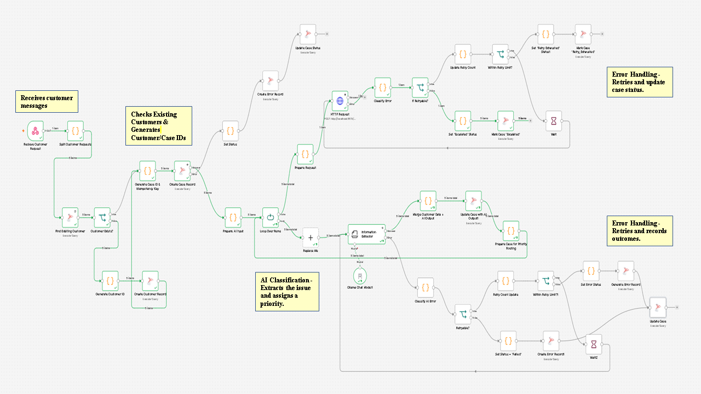
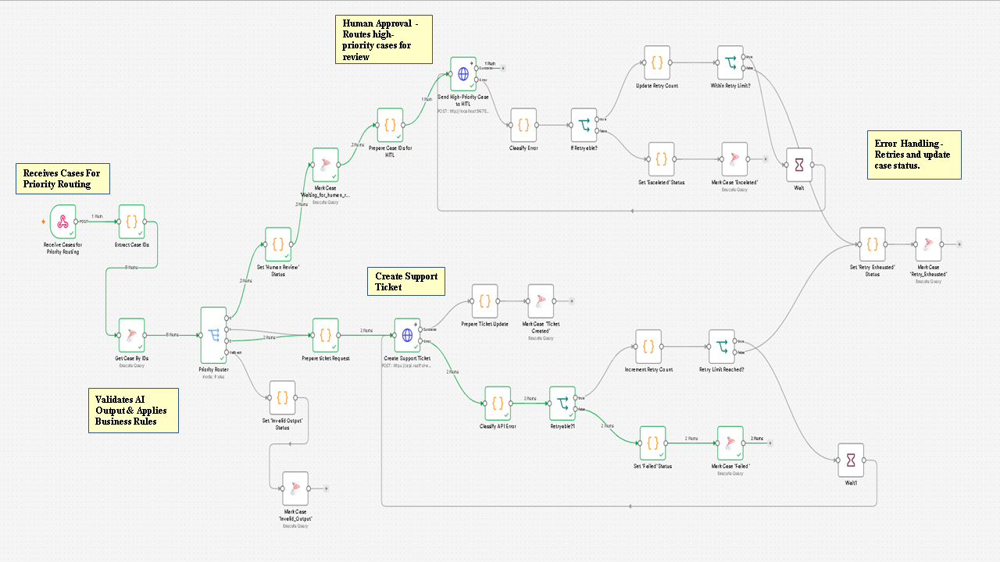
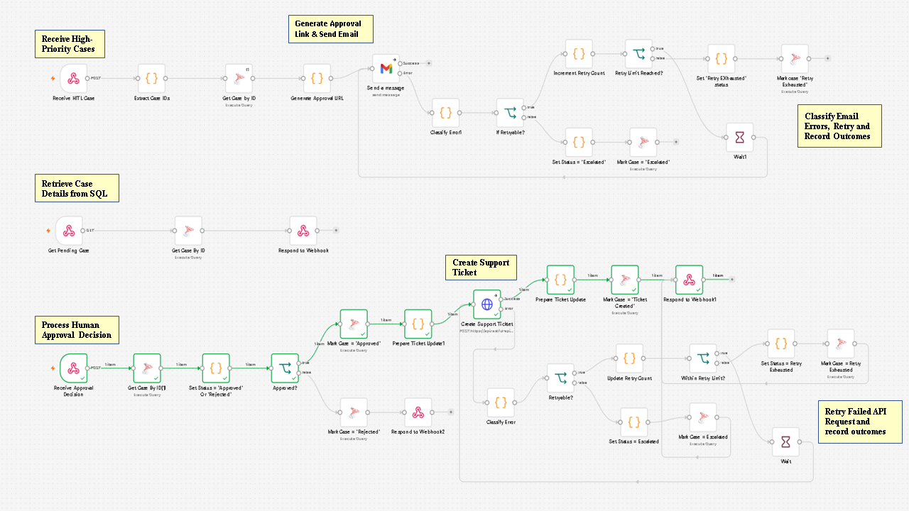

# AI-Powered Customer Support & Ticket Automation
An end-to-end workflow that combines AI, business rules, human review, API integrations, and SQL Server to automate customer support case handling.

## Project Overview
Customer support automation involves more than identifying a customer's issue. A reliable system must also validate decisions, prevent duplicate cases, handle failures, and involve a human when necessary.

I built this project to explore how these pieces work together in a structured workflow — from receiving a customer message to creating a support ticket and tracking its status.

## How It Works:
**1. Customer Identification**: Checks existing customer records and adds new customers when needed.

**2. Case Creation**: Creates support cases with unique IDs and idempotency controls to help prevent duplicate records.

**3. AI Classification**: Uses Ollama and Qwen to extract the issue and assign a priority.

**4. Priority Validation**: Validates AI output against explicit business rules before routing.

**5. Priority-Based Routing**: Routes cases according to priority, sending high-priority cases for human review while processing medium- and low-priority cases through the ticket-creation path.

**6. Human Review**: Sends high-priority cases for approval or rejection through an email-based review process.

**7. Ticket Creation**: Sends approved cases to a REST API and captures the returned ticket ID.

**8. Error Handling**: Classifies selected failures, applies retry logic, and tracks case status in SQL Server.

## Workflow Architecture
The project is organized into connected workflows, separating the main customer-support process from human review and decision handling.

**1. Main Support Workflow**: Receives customer requests, identifies customers, creates case records, classifies issues using the local LLM, validates priorities, and sends cases for priority-based processing.
 
**2. Priority Routing & Ticket Processing**: Receives case IDs, retrieves case information from SQL Server, routes cases by priority, creates tickets for medium- and low-priority cases, and forwards high-priority cases for human review.

**3. Human Review Request**: Retrieves high-priority case details and emails an approval link.

**4. Load Case for Review**: Retrieves case information for the approval interface.

**5. Process Approval Decision**: Records the human decision and routes approved cases toward ticket creation.

## Technology Stack

| Technology | Purpose |
|---|---|
| **n8n** | Workflow orchestration and automation |
| **Ollama + Qwen** | Local LLM-based issue extraction and priority classification |
| **Microsoft SQL Server** | Customer records, case management, status tracking, and duplicate prevention |
| **REST APIs & Webhooks** | Receiving requests, exchanging data, and creating support tickets |
| **JavaScript** | Data transformation, validation, routing logic, and error classification |
| **HTML & JavaScript** | Human approval interface |
| **Python** | Local development server for the approval interface |

## Key Engineering Concepts
- Multi-workflow orchestration
- AI output extraction and validation
- Deterministic business-rule enforcement
- Idempotency and duplicate case prevention
- Human-in-the-loop decision-making
- REST API and webhook integration
- Retry logic and error classification
- Relational database constraints and foreign keys
- Multi-item workflow processing
- Case status tracking

## Installation & Setup

### Prerequisites
- n8n
- Ollama
- Microsoft SQL Server
- Python
- Gmail account for review notifications
- Node.js/npm if required by your chosen n8n installation method

### Set Up Steps
**1. Start Ollama**: Install Ollama and download the model:
    ollama pull qwen3:1.7b

**2. Set up SQL Server**: Create the database and run schema.sql to create the customer table, case table, error log table, and required constraints.

**3. Import the workflows**: In n8n, select **Import from File** and import the main workflow and human review subworkflow JSON files.

**4. Configure credentials**: Create your own SQL Server, Gmail, and Header Auth credentials, then connect them to the appropriate nodes. Imported workflow JSON does not include saved credential secrets.

**5. Run the approval interface (local testing)**: Open PowerShell in the directory containing `approval.html` and run:

```powershell
python -m http.server 3000
```

Open `http://localhost:3000/approval.html` in your browser. 

The approval page is configured for local testing. It communicates with webhook endpoints on your local n8n instance, so both the page and n8n must be running on your computer. If your n8n instance uses different webhook URLs or ports, update the URLs in `approval.html` accordingly.

**Note**: To make the interface accessible to other users, host the HTML page on a publicly accessible web server and configure the webhook endpoints to point to an appropriately secured, publicly reachable n8n instance. Do not expose your local n8n instance or approval webhooks publicly without suitable authentication and access controls.

**6. Test the workflow**: Submit a sample customer message and verify case creation, priority routing, approval/rejection, ticket creation, and database updates.

The example ticket integration uses RESTful API as a demonstration endpoint rather than a production ticketing platform.
 
## Project Screenshots

### Customer Support Workflow

<p align="center">
  
</p>

### Priority Routing & Ticket Processing

<p align="center">
  
</p>g

### Human Review Subworkflow

<p align="center">
  
</p>

## Repository Contents
- workflows/: exported n8n workflow JSON files
- schema.sql: database schema and constraints
- approval.html: human approval interface
- images/: workflow screenshots

## Built to explore practical AI automation, API integration, and reliable business process design.


